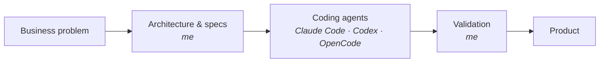

<h1 align="center">Hi 👋, I'm Eduardo Labrador Santos</h1>

  <b>Finance × Technology builder</b> · Madrid, Spain 🇪🇸 
  Computer Engineering + Business Administration (UPM)

  Former Senior Business Consultant in Corporate & Investment Banking. 
  Now an entrepreneur: I turn business problems into my own products, built full time with AI coding agents.

  
  
   
  

  

  
  
  
  

---

## 🧭 About me

- 🏦 **~3 years in Capital Markets consulting** (Management Solutions, CIB). Hands-on with **Calypso**: Java, interfaces, SQL, workflows and configuration, plus Python/SQL tooling around it. Also led strategic transformation work for financial services clients.
- 🤖 **Building with AI agents full time.** I design the architecture, orchestrate coding agents (Claude Code, Codex, OpenCode) and validate what they ship. The bottleneck has moved from writing code to knowing what to build and checking it works.
- ₿ **Crypto since I was 18.** Both of my bachelor's theses were on crypto-assets, I've been active in DeFi since 2020 and completed a Smart Contracts course (University at Buffalo).
- 📈 **Algorithmic trading since 2020.** Built 10+ automated strategies in Python during university, and stress-tested popular "easy money" bots to see if they held up. None did.

### How I work with AI agents

---

## 🚀 What I'm building

### 🔎 Profit Finder &nbsp; 
Screener for arbitrage opportunities across prediction markets.
- Cross-market price matching, built with AI agents

### 💬 eco · social media auto-replies &nbsp; 
Engagement automation for Instagram, Facebook, Threads and YouTube that runs on your own computer: no servers, no subscriptions, official APIs only.
- Keyword rules turn comments into a public reply and/or an automatic DM
- Sends a different message depending on whether the user follows the account (*follow-gate*)
- Schedules posts, and leaves what no rule covers in an inbox for a human to answer
- Simulation mode by default, so every account shows what it *would* send before going live
- 470+ tests against a simulated API · not yet validated against live Instagram

### 🛒 SaaSventas · voice-first inventory & sales &nbsp; 
SaaS for Peruvian retailers to manage sales and inventory by voice or text, through WhatsApp or a mobile web app.
- Built from scratch as a sellable SaaS, with a multi-agent dev workflow
- AI interprets voice/text, but never writes business data directly: stock, permissions and fiscal state stay in deterministic code
- Electronic invoicing queue, multi-tenant Supabase with row-level security
- Launching first in Peru 🇵🇪 with a children's clothing store as the pilot customer

### 🎬 Vertical content automation &nbsp; 
Pipeline to produce and publish vertical video (Shorts, Reels, TikTok) at scale.
- <!-- TODO: añadir 1 línea concreta: qué automatiza (guion, voz, edición, subtítulos, publicación) y con qué stack --> End-to-end automation of short-form content

### 📊 GBPJPY H1 trading system &nbsp;  
Expert Advisor ported from MQL4 to Python for rigorous validation.
- 11 years of tick data, walk-forward optimization (3y IS / 1y OOS)
- An EMA100 trend filter **roughly halved drawdown** at similar PnL and profit factor
- Honest finding: optimized parameters did **not** beat fixed baseline out-of-sample

---

## 🛠️ Languages and Tools

  
  
  
  
  
  
  

**Finance & trading**

  
  
  
  

**AI coding agents**

  
  
  

---

## ✍️ Writing

I write about finance, technology and what I learn building things on [Medium](https://medium.com/@edu_labrador).

## 📫 Let's talk

The fastest way to reach me is [LinkedIn](https://linkedin.com/in/eduardolabradorsantos). Happy to chat about AI products, capital markets tech, crypto or trading systems.
